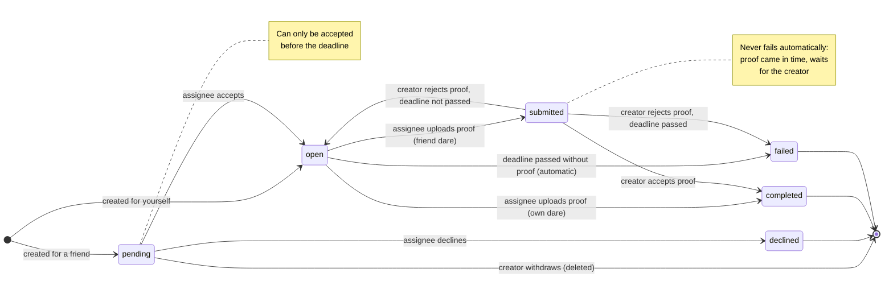

# Dare states

Every state a dare can be in, and how it gets from one to the next.
The rules are enforced in the database (see `supabase/migrations/`), so this is
what *actually* happens — not just what the app shows.

> Keep this file in sync when a migration changes the `dares.status` rules.

## State diagram

## States

| State | Meaning | Who can see it |
|---|---|---|
| `pending` | Sent to a friend, waiting for their answer | Creator and assignee |
| `open` | Running — the assignee has to do it before the deadline | Creator, assignee and their friends\* |
| `submitted` | Proof photo uploaded, waiting for the creator's decision | Creator, assignee and their friends\* |
| `declined` | The friend said no (kept so the creator sees the answer) | Creator and assignee |
| `completed` | Done ✓ — proof accepted (or own dare finished) | Creator, assignee and their friends\* |
| `failed` | Not done ✗ — deadline passed, or proof rejected too late | Creator, assignee and their friends\* |

\* Friends only see it if `visibility = 'friends'` (the default). Proof photos are only
visible to creator and assignee.

## Transitions

| From | To | Who | How (database) | Condition |
|---|---|---|---|---|
| — | `open` | Creator | `insert` → trigger `set_new_dare_status()` | Assignee = creator |
| — | `pending` | Creator | `insert` → trigger `set_new_dare_status()` | Assignee is an accepted friend |
| `pending` | `open` | Assignee | `respond_to_dare(id, true)` | Deadline not passed |
| `pending` | `declined` | Assignee | `respond_to_dare(id, false)` | — |
| `pending` | *(deleted)* | Creator | `delete` (app: `withdrawDare`) | App only deletes while still `pending` |
| `open` | `submitted` | Assignee | `submit_dare_proof(id, path)` | Friend dare, deadline not passed, photo uploaded by the assignee |
| `open` | `completed` | Assignee | `submit_dare_proof(id, path)` | Own dare, deadline not passed |
| `open` | `failed` | System | `fail_overdue_dares()` via pg_cron, every 5 min | Deadline passed |
| `submitted` | `completed` | Creator | `review_dare_proof(id, true)` | — |
| `submitted` | `open` | Creator | `review_dare_proof(id, false)` | Deadline not passed (proof is cleared, new try possible) |
| `submitted` | `failed` | Creator | `review_dare_proof(id, false)` | Deadline passed |

Direct `update`s on `dares` are blocked — every status change goes through one of
these functions, which check who is calling and what state the dare is in.

## Known gaps

- **`pending` after the deadline stays `pending` forever.** It can no longer be
  accepted, but nothing moves it on. Options: let `fail_overdue_dares()` set it to
  `declined` (or a new `expired` state), or hide it in the app.
- **The creator can delete a dare in any state** (database policy "Creator deletes
  dares"). The app only offers this for `pending` (withdraw). Restrict the policy if
  finished or running dares should never disappear.
- **Rejected proof photos stay in Storage**; only the reference is removed.
